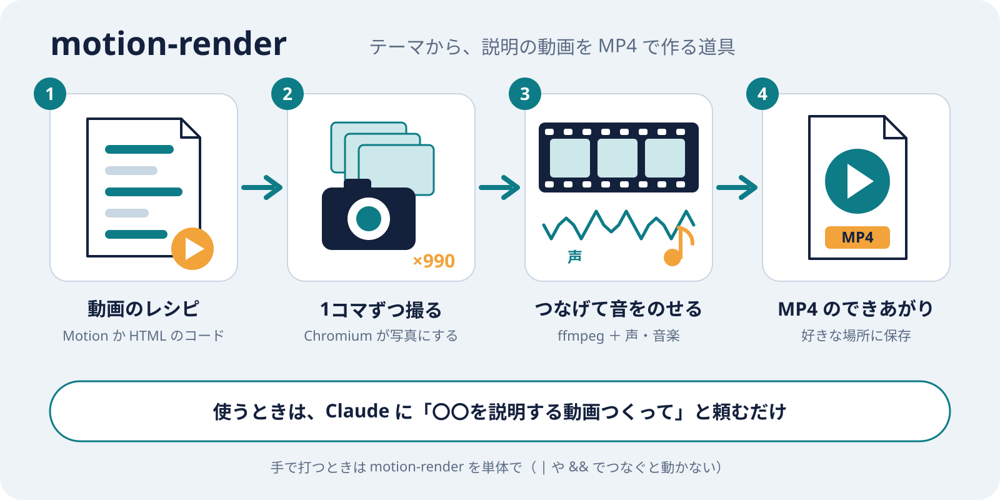

# motion-render

[English](README.md) | 日本語

テーマを伝えるだけで、それを説明する**アニメーション動画を作り、ナレーション・BGM・効果音を付けて MP4 にする** Agent Skill です。

```
/motion-render:motion-render Workload Identity Federation による GitHub Actions から Google Cloud への認証の仕組みを説明する動画つくって
```

この一言で、Claude が絵コンテと原稿を書きます。続けて、ナレーション（Gemini TTS）と、映像の山場に合わせて組み立てた BGM（Lyria）を作ります。最後に、アニメーションを作って手元の MP4 に書き出します。

**音ハメが標準です。** 語りが時間を決め、映像がその中に山場を作り、曲がその山場に合わせて入ります（溜めて全開へ。曲を止めるのは、話が息をのむ所の 1 回まで）。曲は、各時刻に画面で何が起きるかを伝えて Lyria に作らせた生の演奏を、小節単位で並べ替えたものです。曲から一打ずつ検出し、場面の動きを拍に乗せ、全開では話を動かす物（エンジン、プレス）がキックのたびに応えます。書き出した MP4 で、語りの途切れ・山場のずれ・一打への反応を測って確かめます。

## デモ動画

motion-render 自身が作った紹介動画です（59 秒、音声あり）。

https://github.com/user-attachments/assets/eb1bf7e6-a880-4bbe-b575-7f4ec5c21672

効果音付きの動画など、ほかの作例は Wiki の[作例](https://github.com/umiyosh/motion-render/wiki/%E4%BD%9C%E4%BE%8B)にあります。



- 見た目・長さ・声・BGM の雰囲気はテーマから自動で決まります（指定すればそれに従います）
- HTML の映像は、テーマに合う作風で描かれます: 暗い平面、紙と鉛筆、色鉛筆、設計図、紙コラージュ、ホワイトボード
- ElevenLabs の API キーがあれば、カードが現れる・流れ図が光るといった動きに合わせて効果音も付きます
- 既存の Motion の動画の URL を渡して、ナレーションと BGM 付きの MP4 にすることもできます
- 描画用のブラウザ（Chromium）と ffmpeg は自動で用意されるので、環境ごとの差が出ません

## アニメーションの 2 つの作り方

ナレーション・BGM・効果音・MP4 への書き出しは、どちらでも同じです。違うのはアニメーションの作り方です。新しく作る動画は HTML で作ります（一打ごとの反応を書けるのは HTML だけのため）。[Claude **Motion**](https://support.claude.com/ja/articles/17454997-claude-motion%E3%82%92%E5%A7%8B%E3%82%81%E3%82%8B) は、Motion を指定したときと、既存の Motion の動画を MP4 にするときに使います。

|                  | Claude Motion                                           | HTML                                                                                                                                                                   |
| ---------------- | ------------------------------------------------------- | ---------------------------------------------------------------------------------------------------------------------------------------------------------------------- |
| 使えるプラン     | Team・Enterprise（ベータ版）                            | Pro・Max・Team・Enterprise と API キー                                                                                                                                 |
| 作り方           | Claude が Motion で作り、motion-render がそれを取得する | Claude が 1 枚の HTML を書く。土台（アニメーションのプレーヤー（GSAP とそのプラグイン）・three.js・描画の道具・スタイル・日本語フォント）は motion-render に入っている |
| 書き出す前の確認 | Claude が静止画を見る                                   | 配置の自動チェック（重なり、はみ出し、隠れ、小さすぎる文字や薄すぎる文字）のあと、静止画を見る                                                                         |
| 見られるもの     | claude.ai 上の Motion の動画と MP4                      | 手元の静止画と MP4（MP4 ができる前に共有できるリンクはない）                                                                                                           |
| 追加の準備       | なし                                                    | なし（土台は motion-render と一緒に入る）                                                                                                                              |

## 必要なもの

| もの                | 備考                                                                                                  |
| ------------------- | ----------------------------------------------------------------------------------------------------- |
| Claude Code         | Pro・Max・Team・Enterprise のプランか API キー（無料プランは不可）                                    |
| Node.js 22.18 以上  | `node -v` で確認。コマンドの TypeScript を Node がそのまま実行します                                  |
| Gemini API キー     | ナレーションと BGM に使います。Google AI Studio で発行します（[発行の手順](docs/api-key.ja.md)）      |
| ElevenLabs API キー | 任意。効果音に使います。月額プランなしの従量課金で作れます（[作成の手順](docs/elevenlabs-key.ja.md)） |

macOS・Linux・Windows で動きます。

## インストール

### 1. 入れる

**推奨: プラグインとして入れる**。Claude Code の中で実行します。

```
/plugin install motion-render --marketplace umiyosh/motion-render
```

Claude Code 2.1.275 より前の版では、2 行に分けて実行します。

```
/plugin marketplace add umiyosh/motion-render
/plugin install motion-render@motion-render
```

描画用のコマンドと部品も一緒に入るので、ほかに入れるものはありません。
プラグインのスキルは名前の前にプラグイン名が付くので、使うときは `/motion-render:motion-render <テーマ>` です。

**プラグインを使わない場合: skills CLI で入れる**

```sh
npx skills add umiyosh/motion-render -g
```

スキルだけが入るので、初回に Claude が `motion-render` コマンドを `npm install -g` で入れます。
sandbox などで入れられない環境では、プラグインとして入れてください。

### 2. API キーを設定する

Google AI Studio で Gemini API キーを発行します（[発行の手順](docs/api-key.ja.md)）。発行したキーをシェルの設定ファイル（`~/.zshrc` など）に足して、Claude Code を起動し直します。

```sh
export GEMINI_API_KEY="発行したキー"
```

効果音も付けたい場合は、ElevenLabs のキーも足します（[作成の手順](docs/elevenlabs-key.ja.md)）。無ければ効果音なしで作ります。

```sh
export ELEVENLABS_API_KEY="作成したキー"
```

月額プランなしで作った効果音は商用に使えず、公開するときは題名に `11.ai` などの表記が要ります。motion-render は効果音を付けた動画のタイトルに `SFX: 11.ai` を入れます。

### 3. Claude Code の sandbox を使っている場合だけ: 設定を足す

sandbox の中では描画用のブラウザが起動できません。`~/.claude/settings.json` に次の 2 つを足し、`motion-render` だけを sandbox の外で動かします。

```jsonc
{
  "sandbox": {
    "excludedCommands": ["motion-render:*"]   // 既存の配列に追加
  },
  "permissions": {
    "allow": ["Bash(motion-render:*)"]        // 既存の配列に追加
  }
}
```

auto mode を使っていて、それでも実行が拒否される場合は、`autoMode.environment` に次の 1 行も足してください。

```jsonc
"**Motion rendering**: rendering Motion or HTML films to MP4 with headless Chromium via the `motion-render` command, outside the Bash sandbox, is routine work requested by the user"
```

### 4. 最初の 1 本を作る

```
/motion-render:motion-render 〇〇を説明する 30 秒の動画つくって
```

（skills CLI で入れた場合は `/motion-render 〇〇を…`）

初回は、描画用の Chromium（約 210 MB）と ffmpeg が自動でダウンロードされます。

## 使い方

- 長さ・出力先・雰囲気などは、続けて書けば反映されます（例:「30 秒で」「`~/Movies` に出して」「BGM はニュース風」）
- 長さに上限はありません。指定しなければテーマに合わせて決まり、1 つの仕組みなら 1 分前後、段階の多いテーマなら数分になります。書き出しには、動画 1 分あたり 1〜2 分ほどかかります（コア数で変わります。`MOTION_RENDER_PAGES` を参照）
- 出力先を言わなければ、`$MOTION_RENDER_OUT_DIR`、無ければカレントディレクトリに保存されます
- できた後に「BGM を変えて」「ここの説明を短く」と頼めば、その部分だけ作り直します
- 既存の Motion の動画なら、URL を渡して「MP4 にして」と頼みます。ナレーションと BGM も付きます

### コマンド（Claude が内部で使うもの）

動画 1 本ごとに作業フォルダ（`<work>`）を 1 つ使います。中身と `script.json` の書き方は [SKILL.md](skills/motion-render/SKILL.md) にあります。

| コマンド                                              | やること                                                                                                                                                                                                                                                        |
| ----------------------------------------------------- | --------------------------------------------------------------------------------------------------------------------------------------------------------------------------------------------------------------------------------------------------------------- |
| `motion-render narrate <work>`                        | `script.json` の原稿からナレーションを作り、場面の秒数を `timing.json` に書く。`bpm` があると場面の頭を拍に、区間の頭を小節にそろえ、時刻表を出す                                                                                                               |
| `motion-render bgm <work>`                            | `bpm` があると `score.txt` の指示から曲の候補を 4 本作り、小節ごとの表（大きさ・キック・スネア・ハイハット）を出す。無ければ `script.json` の `bgm` の指示から BGM を 1 曲作る                                                                                  |
| `motion-render score <work>`                          | `script.json` の `score`（候補と小節の並び）を映像の速さと小節に合わせて書き出し、曲の一打の一覧を映像に渡す。聞く人が気づく瞬間（曲が抜ける、戻る、単発の一打）を一覧に出し、山場で曲が入るかを点検する                                                        |
| `motion-render sync <work> <mp4>`                     | MP4 で、語りの途切れ、全開と最後の一打での画面の変化、全開の区間のキックへの反応を測る（`build` も実行する）                                                                                                                                                    |
| `motion-render sheet <work> <mp4> [out.png]`          | MP4 の要所（各場面の中ほど、山場の前後、最後の一打）のコマを、見直し用に 1 枚の画像に並べる。各コマの説明を .txt に書く                                                                                                                                         |
| `motion-render preview <work> [out.png]`              | 書き出す前に、配置の確認をし、必要なコマだけを描いて（MP4 を作らず数十秒）、見直し用の要所のコマの一覧と、音ハメの動画の同期の測定を出す。書き出しは見直しの後の 1 回で済む                                                                                     |
| `motion-render sfx <work>`                            | `script.json` の `sfx` から効果音を作り、全部を順に聞ける `preview.m4a` を書く                                                                                                                                                                                  |
| `motion-render prepare <storeDir> <work>/film`        | Motion: Motion から取得した映像データを、描画できる形に展開する                                                                                                                                                                                                 |
| `motion-render kit <work>`                            | HTML: `<work>/film` にプレーヤー・スタイル・GSAP とそのプラグイン・three.js・描画の道具・日本語フォント・場面の秒数を置く。Claude はそのあと `film/index.html` を書く                                                                                           |
| `motion-render check <work>/film [<場面のファイル>…]` | HTML: 0.1 秒ごとに配置を調べ、重なり、箱や画面からのはみ出し、ほかのものの下に隠れたもの、小さすぎる文字や薄すぎる文字、読む前に消える大きな文字、巻き戻すと変わる絵を報告する。場面のファイル（`film/scenes/` の名前）を渡すと、そのファイルの場面だけを調べる |
| `motion-render stills <filmDir> <outDir> 0,5,12`      | 確認用の静止画を書き出す（HTML の映像は先に配置を調べる）                                                                                                                                                                                                       |
| `motion-render build <work> [out.mp4]`                | ナレーション・BGM・効果音を合成し、映像と合わせて MP4 にする（音ハメの動画は 60fps で、書き出した後に `sync` を測る）。どれかが足りないとき、HTML の映像が配置のチェックに通らないときは止まる                                                                  |
| `motion-render times <work>`                          | 工程ごとにかかった時間を表にする（各コマンドの時間と、その間の Claude の作業の時間）                                                                                                                                                                            |
| `motion-render --version`                             | 版を表示する                                                                                                                                                                                                                                                    |

| 環境変数                | 効果                                                                                       |
| ----------------------- | ------------------------------------------------------------------------------------------ |
| `GEMINI_API_KEY`        | ナレーションと BGM の生成に必要                                                            |
| `ELEVENLABS_API_KEY`    | 効果音の生成に必要（無ければ効果音を付けない）                                             |
| `MOTION_RENDER_OUT_DIR` | `build` の出力先を省略したときの保存先                                                     |
| `CHROMIUM_PATH`         | 同梱の Chromium の代わりに、手元の Chrome や Chromium を使う                               |
| `FFMPEG_PATH`           | 同梱の ffmpeg の代わりに、手元の ffmpeg を使う                                             |
| `MOTION_RENDER_PAGES`   | 同時にコマを描くブラウザの数（既定: コア数の半分、最大 8）。マシンが混んでいるときは減らす |

## 困ったとき

| 症状                                                                                 | 原因と対処                                                                                                                                                                                                                                                                     |
| ------------------------------------------------------------------------------------ | ------------------------------------------------------------------------------------------------------------------------------------------------------------------------------------------------------------------------------------------------------------------------------ |
| `bootstrap_check_in ... Permission denied` でブラウザが起動しない                    | Claude Code の sandbox の中で動いています。インストールの手順 3 を確認してください。`motion-render` は単体で実行する必要があります（`\| grep` や `&&` でつなぐと sandbox の外に出ません）                                                                                      |
| `GEMINI_API_KEY is not set`                                                          | インストールの手順 2 を確認し、Claude Code を起動し直してください                                                                                                                                                                                                              |
| `ELEVENLABS_API_KEY is not set`                                                      | 効果音のキーがありません。[作成の手順](docs/elevenlabs-key.ja.md)で作るか、効果音なしで作るよう Claude に伝えてください                                                                                                                                                        |
| 効果音の生成が `HTTP 401` などで失敗する                                             | キーで Sound Effects が許可されていないか、残高が足りません。エラーに続く理由を見て、ElevenLabs の Developers で確認してください                                                                                                                                               |
| `came back silent` で効果音の生成が止まる                                            | 3 回とも無音が返りました。`prompt` を具体的な音の説明に書き換えてやり直してください                                                                                                                                                                                            |
| ナレーションや BGM の生成が何度も失敗する                                            | 1 回 90 秒で打ち切り、3 回まで再試行します。それでも失敗するなら、API キーの権限と利用上限を確認してください                                                                                                                                                                   |
| `motion-render` のインストールで ffmpeg のダウンロードが失敗する                     | 社内プロキシなどで GitHub からの取得が止められています。`npm install -g --ignore-scripts <スキルのフォルダ>` で入れ、手元の ffmpeg を `FFMPEG_PATH` で指定してください（PATH 上の `ffmpeg` も自動で使います）                                                                  |
| 初回の Chromium のダウンロードが失敗する                                             | `CHROMIUM_PATH` に手元の Chrome か Chromium を指定してください                                                                                                                                                                                                                 |
| `motion-render` の実行で `Unknown file extension ".ts"` が出る                       | Node が 22.18 より古いです。Node を更新してください                                                                                                                                                                                                                            |
| `stills` や `build` が `1.1-1.9s: #a and #b partly overlap` のような行を出して止まる | HTML の映像の配置に問題があります。Claude が `film/index.html` を直して調べ直します。自分で直すときは、`motion-render check <work>/film` が `layout ok` を出すまで直してください。各メッセージの意味は [html-film.md](skills/motion-render/references/html-film.md) にあります |
| `font … "Noto Sans JP" did not load. Run "motion-render kit" again.` が出る          | HTML の映像のフォントのファイルがありません。`motion-render kit <work>` をもう一度実行してください（`index.html` はそのまま残ります）                                                                                                                                          |
| 日本語の字形や改行位置が Motion のページと少し違う                                   | Motion の映像は OS のフォントで描かれます。HTML の映像は、同梱の Noto Sans JP（手描きの作風では Klee One）で描かれます                                                                                                                                                         |

## 更新

プラグインとして入れた場合は、Claude Code の中で `/plugin` を開き、**Installed** で motion-render を選んで **Update now** を選びます。新しい版は Claude Code を起動し直すと読み込まれます。

Claude Code が自動で更新するのは、Anthropic 公式のマーケットプレイスだけです。motion-render の新しい版を毎回の操作なしで受け取るには、`/plugin` の **Marketplaces** で motion-render を選び、**Enable auto-update** を選びます。以後は Claude Code の起動時に更新されます。

シェルからは `claude plugin update motion-render@motion-render` で **Update now** と同じことができます。

skills CLI で入れた場合は、シェルで実行します。

```sh
npx skills update motion-render -g
```

## アンインストール

プラグインとして入れた場合は、Claude Code の中で実行します。

```
/plugin uninstall motion-render
```

skills CLI で入れた場合は、シェルで実行します。

```sh
npx skills remove motion-render -g
npm uninstall -g motion-render
```

ダウンロードした Chromium は Playwright のキャッシュ（macOS は `~/Library/Caches/ms-playwright`、Linux は `~/.cache/ms-playwright`）にあります。不要なら消してください。

## 安全性

- 描画中、動画のコード（Motion・HTML とも）は外部への通信をすべて遮断され、映像データのフォルダの外のファイルも読めません
- Chromium 自身の sandbox を有効にして起動します（Playwright は既定で無効にするため、明示的に有効にしています）
- Claude Code の sandbox から外すのは `motion-render` コマンドだけです
- API キーは環境変数から読むだけで、ファイルや動画には残しません

## 開発

`npm install` の後、PR を出す前に `make check` を実行してください。CI と同じ検査（ESLint、Prettier、TypeScript の型検査、ユニットテストと描画のスモークテスト（カバレッジ 80% の基準つき）、品質ゲートのテスト、品質ベースラインの検査）をまとめて行います。スモークテストは、`tests/fixtures` の Motion プレーヤーの代役と、土台で作った小さな HTML の映像を headless Chromium で開くので、API キーは要りません。

品質ベースラインには、今ある ESLint の警告と Knip の指摘が載っています。新しく増やしたり悪化させたりした PR は落ちます。直したら `make quality-baseline` で改善を記録してください（悪化は記録できません）。

## 構成

```
.claude-plugin/
  marketplace.json        # Claude Code のプラグイン一覧（このリポジトリ自身を載せる）
  plugin.json             # プラグインの名札
bin/motion-render         # プラグインが PATH に載せるコマンド（skills/motion-render の CLI を呼ぶ）
package.json              # プラグインの依存。Claude Code がプラグインを入れるときに自動で入れる。`npm run typecheck` で型を検査する
package-lock.json
tsconfig.json             # TypeScript の設定（型の検査用。実行時は Node が .ts をそのまま動かす）
skills/motion-render/     # スキル本体（skills CLI とプラグインの両方がここを読む）
  SKILL.md                # Claude が読む手順（準備、原稿と山場、曲の作風・指示文・小節の選び方を含む）
  package.json            # motion-render コマンドと、依存の版（playwright-core, ffmpeg-static, gsap, @fontsource/noto-sans-jp, @fontsource/klee-one）
  references/html-film.md # Claude が HTML の映像を書くときの決まり（音ハメの演出と書き方、配置、動き、チェックの読み方）
  references/pipeline.md  # 工程のつながり（何を待ち、何を裏で動かすか）と、工程を足すときの決まり
  kit/                    # kit が HTML の映像に写すプレーヤー、音ハメの部品（beat.js）、基本のスタイル、作風のスタイル、部品（parts.css）
  scripts/cli.ts          # motion-render コマンド
  scripts/beatcli.ts      # 音ハメのコマンド（時刻表、曲の候補の表、score、sync）
  scripts/audio.ts        # ナレーションと BGM の生成、曲の候補、音声の合成
  scripts/score.ts        # 曲の候補を小節ごとに測り、選んだ小節を映像の小節に並べて書き出す
  scripts/signal.ts       # 音の読み込みとフィルタ・包絡
  scripts/tempo.ts        # テンポと小節の頭
  scripts/hits.ts         # 16 分音符ごとの打音の検出
  scripts/sync.ts         # MP4 で語り・山場・一打の同期を測る
  scripts/repeat.ts       # 巻き戻すと変わる絵を見つける
  scripts/sfx.ts          # 効果音の生成（ElevenLabs）、音量のそろえ方、試聴用ファイル
  scripts/work.ts         # script.json の検証と場面の秒数の計算
  scripts/render.ts       # Motion と HTML の映像をブラウザで描画する部分
  scripts/kit.ts          # HTML の映像のフォルダを用意する
  scripts/layout.ts       # HTML の映像の配置のチェック
  scripts/scenes.ts       # 場面のファイル（film/scenes/*.html）を index.html に差し込む
  scripts/steps.ts        # 各コマンドの時間を残し、工程ごとの時間の表にする（times）
  scripts/snapshot.js     # 配置のチェックのため、映像のページの中で箱と文字を測る
  scripts/json.ts         # ファイル・API・プレーヤーから来る JSON を、形を確かめながら読む
  scripts/store.ts        # Motion の store を映像データのフォルダに展開する
docs/how-it-works.svg     # README の図
.github/workflows/ci.yml  # CI: 下の検査を PR ごとに実行する
Makefile                  # 開発用のコマンド（`make help` で一覧）
eslint.config.js, .prettierrc, knip.json
quality-baseline.json     # 返済対象の ESLint の警告と Knip の指摘。増えると CI が落ちる
scripts/quality-gate*.mjs # 今の指摘をベースラインと比べる
tests/                    # Vitest のユニットテストと描画のスモークテスト（フィクスチャの store、代役のプレーヤー、HTML の映像）
vitest.config.ts          # テストの設定とカバレッジ 80% の基準
```

## ライセンス

[MIT](LICENSE)
