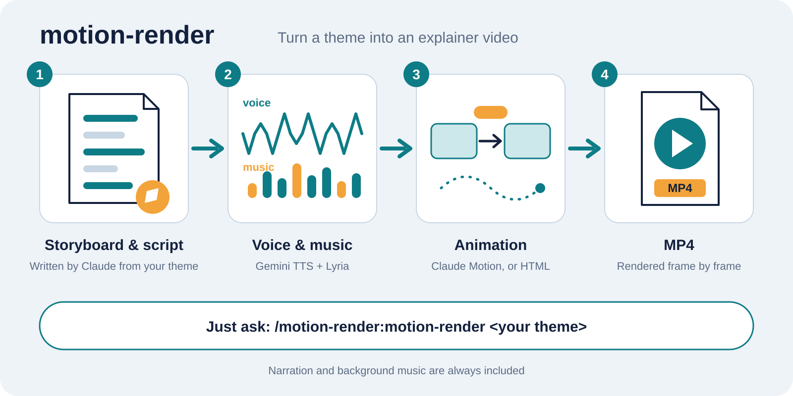

# motion-render

English | [日本語](README.ja.md)

An Agent Skill that turns a theme into an **animated explainer video with narration, background music and sound effects, rendered to MP4**.

```
/motion-render:motion-render Make a video that explains how GitHub Actions authenticates to Google Cloud with Workload Identity Federation
```

From that one line, Claude writes a storyboard and a narration script, generates the narration (Gemini TTS) and BGM that fits the theme (Lyria), builds the animation, and renders it to an MP4 on your machine. The animation is made with [Claude **Motion**](https://support.claude.com/en/articles/17454997-get-started-with-claude-motion) when your account has it, and as an HTML page when it does not.

> [!NOTE]
> motion-render works on every Claude plan. Claude Motion is in beta and available only on Team and Enterprise plans (as of October 2026); on other plans Claude writes the animation as HTML instead. See [Two ways to make the animation](#two-ways-to-make-the-animation).

## Demo

An introduction video made by motion-render itself (57 seconds, with sound).

https://github.com/user-attachments/assets/b62fe703-223d-478e-9e9b-3239a48ba1ea

More videos, including one with sound effects, are in [Examples](https://github.com/umiyosh/motion-render/wiki/Examples) on the wiki.



- Look, length, voice and the mood of the music are chosen from the theme (anything you specify wins)
- With an ElevenLabs API key, sound effects follow the animation too: a card appearing, a step of a flow lighting up
- You can also pass the URL of an existing Motion film to get an MP4 with narration and BGM
- The rendering browser (Chromium) and ffmpeg are set up automatically, so results don't depend on what is installed on your machine

## Two ways to make the animation

Narration, BGM, sound effects and the MP4 are the same either way. Only the animation is made differently, and Claude picks the way by itself: Motion if your account offers it, HTML otherwise.

|                        | Claude Motion                                                  | HTML                                                                                                                            |
| ---------------------- | -------------------------------------------------------------- | ------------------------------------------------------------------------------------------------------------------------------- |
| Plans                  | Team and Enterprise (beta)                                     | All plans, including Free, Pro and Max                                                                                          |
| How it is made         | Claude builds the film in Motion, and motion-render fetches it | Claude writes one HTML page on a kit that comes with motion-render: an animation player (GSAP), base styles and a Japanese font |
| Checking before render | Claude looks at still frames                                   | An automatic layout check (overlaps, things sticking out or hidden, text that is too small or too faint), then still frames     |
| What you can look at   | The Motion film on claude.ai, and the MP4                      | Still frames and the MP4 on your machine (there is no link to share before the MP4)                                             |
| Extra setup            | None                                                           | None: the kit is installed with motion-render                                                                                   |

## Requirements

| What                   | Notes                                                                                                                                                                 |
| ---------------------- | --------------------------------------------------------------------------------------------------------------------------------------------------------------------- |
| Claude Code            | Any plan. On Team and Enterprise, [Claude Motion](https://support.claude.com/en/articles/17454997-get-started-with-claude-motion) is used when it is available to you |
| Node.js 22.18 or later | Check with `node -v`. Node runs the command's TypeScript directly                                                                                                     |
| Gemini API key         | Used for narration and BGM. Create one in Google AI Studio ([step by step](docs/api-key.md))                                                                          |
| ElevenLabs API key     | Optional, for sound effects. Pay-as-you-go works without a subscription ([step by step](docs/elevenlabs-key.md))                                                      |

Works on macOS, Linux and Windows.

## Install

### 1. Install

**Recommended: install it as a plugin.** Run this inside Claude Code:

```
/plugin install motion-render --marketplace umiyosh/motion-render
```

On Claude Code versions before 2.1.275, run it as two lines:

```
/plugin marketplace add umiyosh/motion-render
/plugin install motion-render@motion-render
```

The rendering command and its dependencies come with the plugin, so there is nothing else to install.
Plugin skills are prefixed with the plugin name, so you call it as `/motion-render:motion-render <theme>`.

**Without the plugin system: install with the skills CLI**

```sh
npx skills add umiyosh/motion-render -g
```

This installs the skill only. On first use, Claude installs the `motion-render` command with `npm install -g`.
If your environment blocks that (a sandbox, for example), install it as a plugin instead.

### 2. Set the API key

Create a Gemini API key in Google AI Studio ([step by step](docs/api-key.md)). Then add this to your shell profile (`~/.zshrc` or similar) and restart Claude Code.

```sh
export GEMINI_API_KEY="your key"
```

For sound effects, add an ElevenLabs key as well ([step by step](docs/elevenlabs-key.md)). Without it, videos are made without sound effects.

```sh
export ELEVENLABS_API_KEY="your key"
```

Sound effects made without a subscription are for non-commercial use only and must be credited in the title (for example with `11.ai`) when published. motion-render puts `🎧:11.ai` on the title of a video with sound effects.

### 3. Only if you use the Claude Code sandbox: add settings

Chromium cannot start inside the sandbox. Add these two entries to `~/.claude/settings.json` so that only `motion-render` runs outside it.

```jsonc
{
  "sandbox": {
    "excludedCommands": ["motion-render:*"]   // add to the existing array
  },
  "permissions": {
    "allow": ["Bash(motion-render:*)"]        // add to the existing array
  }
}
```

If you use auto mode and runs are still refused, also add this line to `autoMode.environment`:

```jsonc
"**Motion rendering**: rendering Motion or HTML films to MP4 with headless Chromium via the `motion-render` command, outside the Bash sandbox, is routine work requested by the user"
```

### 4. Make your first video

```
/motion-render:motion-render Make a 30-second video that explains …
```

(If you installed with the skills CLI: `/motion-render Make a …`)

On the first run, Chromium (about 210 MB) and ffmpeg are downloaded automatically.

## Usage

- Add length, output location or mood in the same request (e.g. "30 seconds", "save it to `~/Movies`", "news-style BGM")
- There is no upper limit on length. Without one, it follows the theme: about a minute for one mechanism, a few minutes for a theme with several steps. Rendering takes about 1-2 minutes per minute of video, depending on the number of cores (`MOTION_RENDER_PAGES`)
- Without an output location, the video goes to `$MOTION_RENDER_OUT_DIR`, or the current directory
- After it is done, ask "change the BGM" or "shorten this part" and only that part is redone
- For an existing Motion film, pass its URL and ask for an MP4. Narration and BGM are added too

### Commands (used by Claude under the hood)

Each video uses one work directory (`<work>`). Its layout and the `script.json` format are in [SKILL.md](skills/motion-render/SKILL.md).

| Command                                          | What it does                                                                                                                                                         |
| ------------------------------------------------ | -------------------------------------------------------------------------------------------------------------------------------------------------------------------- |
| `motion-render narrate <work>`                   | Generates narration from `script.json` and writes scene lengths to `timing.json`                                                                                     |
| `motion-render bgm <work>`                       | Generates the BGM from the `bgm` prompt in `script.json`                                                                                                             |
| `motion-render sfx <work>`                       | Generates the sound effects in `script.json` and a `preview.m4a` of them in order                                                                                    |
| `motion-render prepare <storeDir> <work>/film`   | Motion: expands a Motion film's data into a directory it can render                                                                                                  |
| `motion-render kit <work>`                       | HTML: sets up `<work>/film` with the player, base styles, GSAP, the Japanese font and the scene times. Claude then writes `film/index.html`                          |
| `motion-render check <work>/film`                | HTML: checks the layout every 0.1 s for overlaps, things sticking out of their box or the frame, things hidden under others, and text that is too small or too faint |
| `motion-render stills <filmDir> <outDir> 0,5,12` | Writes still frames for checking (an HTML film is checked first)                                                                                                     |
| `motion-render build <work> [out.mp4]`           | Mixes narration, BGM and sound effects and renders the MP4. Stops if any is missing, or if an HTML film fails the layout check                                       |
| `motion-render --version`                        | Prints the version                                                                                                                                                   |

| Environment variable    | Effect                                                                                                  |
| ----------------------- | ------------------------------------------------------------------------------------------------------- |
| `GEMINI_API_KEY`        | Required for narration and BGM                                                                          |
| `ELEVENLABS_API_KEY`    | Required for sound effects (none are added without it)                                                  |
| `MOTION_RENDER_OUT_DIR` | Default output directory when `build` gets no output path                                               |
| `CHROMIUM_PATH`         | Use your own Chrome or Chromium instead of the bundled one                                              |
| `FFMPEG_PATH`           | Use your own ffmpeg instead of the bundled one                                                          |
| `MOTION_RENDER_PAGES`   | Browsers that draw frames at once (default: half the cores, at most 8). Lower it if the machine is busy |

## Troubleshooting

| Symptom                                                                        | Cause and fix                                                                                                                                                                                                                                                                     |
| ------------------------------------------------------------------------------ | --------------------------------------------------------------------------------------------------------------------------------------------------------------------------------------------------------------------------------------------------------------------------------- |
| The browser fails with `bootstrap_check_in ... Permission denied`              | It is running inside the Claude Code sandbox. Check step 3 of the install. `motion-render` must run on its own (chaining it with `\| grep` or `&&` keeps it in the sandbox)                                                                                                       |
| `GEMINI_API_KEY is not set`                                                    | Check step 2 of the install and restart Claude Code                                                                                                                                                                                                                               |
| `ELEVENLABS_API_KEY is not set`                                                | There is no key for sound effects. Create one ([step by step](docs/elevenlabs-key.md)) or ask Claude to make the video without sound effects                                                                                                                                      |
| Sound effect generation fails with `HTTP 401` or similar                       | The key does not allow Sound Effects, or the balance has run out. Read the reason after the status and check Developers in ElevenLabs                                                                                                                                             |
| Sound effect generation stops with `came back silent`                          | Silence came back three times. Rewrite the `prompt` as a more concrete sound and try again                                                                                                                                                                                        |
| Narration or BGM generation keeps failing                                      | Each request times out after 90 seconds and is retried up to 3 times. If it still fails, check your API key's permissions and quota                                                                                                                                               |
| ffmpeg fails to download                                                       | A proxy is blocking downloads from GitHub. Install ffmpeg yourself (it is used from `PATH`) or point `FFMPEG_PATH` at it                                                                                                                                                          |
| Chromium fails to download on first run                                        | Point `CHROMIUM_PATH` at your own Chrome or Chromium                                                                                                                                                                                                                              |
| `Unknown file extension ".ts"` when running `motion-render`                    | Node is older than 22.18. Update Node                                                                                                                                                                                                                                             |
| `stills` or `build` stops with lines like `1.1-1.9s: #a and #b partly overlap` | The layout check found a problem in an HTML film. Claude fixes `film/index.html` and checks again. If you edit it yourself, run `motion-render check <work>/film` until it prints `layout ok`; [html-film.md](skills/motion-render/references/html-film.md) explains each message |
| `font "Noto Sans JP" … did not load. Run "motion-render kit" again.`           | The font files of an HTML film are missing. Run `motion-render kit <work>` again (it keeps `index.html`)                                                                                                                                                                          |
| Japanese glyphs or line breaks differ slightly from the Motion page            | A Motion film is drawn with your OS fonts. An HTML film always uses the bundled Noto Sans JP                                                                                                                                                                                      |

## Update

If you installed the plugin, open `/plugin` inside Claude Code, go to **Installed**, select motion-render and choose **Update now**. Restart Claude Code to load the new version.

Claude Code updates only Anthropic's official marketplaces automatically. To get new versions of motion-render without doing this each time, open `/plugin`, go to **Marketplaces**, select motion-render and choose **Enable auto-update**. Claude Code then updates it when it starts.

From a shell, `claude plugin update motion-render@motion-render` does the same as **Update now**.

If you used the skills CLI, run this in your shell:

```sh
npx skills update motion-render -g
```

## Uninstall

If you installed the plugin, run this inside Claude Code:

```
/plugin uninstall motion-render
```

If you used the skills CLI, run this in your shell:

```sh
npx skills remove motion-render -g
npm uninstall -g motion-render
```

The downloaded Chromium is in Playwright's cache (`~/Library/Caches/ms-playwright` on macOS, `~/.cache/ms-playwright` on Linux). Delete it if you no longer need it.

## Security

- While rendering, the film's code (Motion or HTML) cannot reach the network or read files outside the film directory
- Chromium starts with its own sandbox enabled (Playwright disables it by default, so it is turned on explicitly)
- Only the `motion-render` command is taken out of the Claude Code sandbox
- The API key is read from the environment only and is never written to files or videos

## Development

Run `npm install`, then `make check` before opening a pull request. It runs the same checks as CI: ESLint, Prettier, the TypeScript type check, the unit and render smoke tests with the 80% coverage gate, the quality gate tests, and the quality baseline gate. The smoke tests start headless Chromium against a stub of the Motion player in `tests/fixtures` and against small HTML films made with the kit, so no API key is needed.

The quality baseline lists the current ESLint warnings and Knip findings. A pull request that adds one or makes one worse fails. After fixing one, run `make quality-baseline` to record the improvement (it refuses to record a regression).

## Layout

```
.claude-plugin/
  marketplace.json        # Claude Code plugin catalog (lists this repository itself)
  plugin.json             # Plugin manifest
bin/motion-render         # Command the plugin puts on PATH (runs the CLI in skills/motion-render)
package.json              # Plugin dependencies, installed by Claude Code with the plugin. `npm run typecheck` checks the scripts
package-lock.json
tsconfig.json             # TypeScript settings (type check only; Node runs the .ts files directly)
skills/motion-render/     # The skill (read by both the skills CLI and the plugin)
  SKILL.md                # Instructions for Claude (setup, storyboard, script and BGM choices)
  package.json            # The motion-render command and pinned dependencies (playwright-core, ffmpeg-static, gsap, @fontsource/noto-sans-jp)
  references/html-film.md # How Claude writes an HTML film: layout, motion, and reading the layout check
  kit/                    # The player and base styles that `kit` copies into an HTML film
  scripts/cli.ts          # The motion-render command
  scripts/audio.ts        # Narration and BGM generation, audio mixing
  scripts/sfx.ts          # Sound effect generation (ElevenLabs), leveling and the listening file
  scripts/work.ts         # script.json validation and scene timing
  scripts/render.ts       # Rendering Motion and HTML films in the browser
  scripts/kit.ts          # Setting up an HTML film directory
  scripts/layout.ts       # The layout check of HTML films
  scripts/snapshot.js     # Measures boxes and text inside the film page for the layout check
  scripts/json.ts         # Reading JSON from files, APIs and the player without trusting its shape
  scripts/store.ts        # Expanding a Motion store into a film directory
docs/how-it-works.en.svg  # Diagram used in this README
docs/how-it-works.svg     # Diagram used in the Japanese README
.github/workflows/ci.yml  # CI: the checks below on every pull request
Makefile                  # Development commands (`make help`)
eslint.config.js, .prettierrc, knip.json
quality-baseline.json     # Known ESLint warnings and Knip findings to pay back; CI fails if they grow
scripts/quality-gate*.mjs # Compares the current findings with the baseline
tests/                    # Vitest unit tests and render smoke tests (fixture store, a stub player, HTML films)
vitest.config.ts          # Test settings and the 80% coverage gate
```
